# 光台 · 序列帧工作室 操作手册

更新于 2026-10-23

## 1. 简介

光台 · 序列帧工作室是一个在本机运行的序列帧处理与绘制工具：在无限画布上用节点卡片串起「去背景 → 完美像素 → 切片 → 对齐 → 调色 → 预览 / 导出」，每一步都能单独调参、旁路或替换，结果实时更新。

它由四个工作区组成，日常使用基本围绕它们展开：

| 工作区 | 怎么进入 | 用来做什么 |
| --- | --- | --- |
| 节点画布（首页） | 启动后默认就是 | 导入素材，连接处理节点，预览并导出 |
| 像素编辑器 | 双击「动画」卡片 | 逐帧手绘、修图，添加攻击拖尾、拖尾笔、特效图层、残影 |
| 调帧台 | 双击「角色」卡片 | 把多组动画对齐到同一原点，调偏移 / 缩放 / 时长，绑定音效，导出角色包 |
| 特效节点 | 左侧栏添加「特效」卡片 | 单独生成命中火花、爆炸、魔法阵、翅膀等特效序列帧 |

项目以普通文件夹保存，改动约 0.7 秒后自动写盘，并每 10 分钟留一份历史版本（最多 30 份）。

## 2. 启动与项目管理

只需要 Node.js 18 或更新版本，没有其他依赖，也不用 `npm install`。

1. 安装 Node.js（[nodejs.org](https://nodejs.org/)，18 或更新）。
2. 双击项目根目录的 `start.bat`，浏览器会自动打开工作室；也可以在命令行运行 `npm start`，再访问 http://127.0.0.1:5288/ 。
3. 第一次启动会自动新建「我的第一个项目」；之后每次打开都回到上次离开的项目、画布位置和选中状态。
4. 用完后关掉 `start.bat` 的黑窗口，服务就停止了。

服务只监听本机 127.0.0.1，局域网里的其他电脑访问不到。

### 项目文件夹

每个项目就是一个普通文件夹，默认建在 `projects/<项目名>/`，新建时也可以选任意位置：

| 文件 / 文件夹 | 内容 |
| --- | --- |
| `project.gtproj` | 项目文档：卡片、连线、参数，以及视角、选中等界面状态 |
| `assets/` | 图片素材，按内容哈希命名，同一张图只存一份 |
| `backups/` | 自动历史版本，每 10 分钟最多一份，保留最近 30 份 |

### 项目菜单

点顶栏的项目名（如「测试 ▾」）打开项目菜单：

- **新建 / 打开 / 另存为**：打开时选择 `.gtproj` 文件。
- **历史版本**：从 `backups/` 里挑一份还原。
- **在资源管理器中显示**：打开项目所在文件夹。
- **清理未使用素材…**：把当前项目、全部历史版本和撤销记录都不再引用的素材移到 `data/trash`，不直接删除；像素编辑器打开时不能清理。
- **打开旧版单页工具**：原来的 `序列帧动画工具.html` 仍可从这里访问。

改动约 0.7 秒后自动保存，顶栏会显示「已保存」；按 Ctrl+S 立即保存。删除项目只会把文件夹移到 `data/trash/`。

## 3. 界面总览

首页是一块无限画布：左边是节点栏，中间放卡片和连线，右边是选中卡片的属性面板。

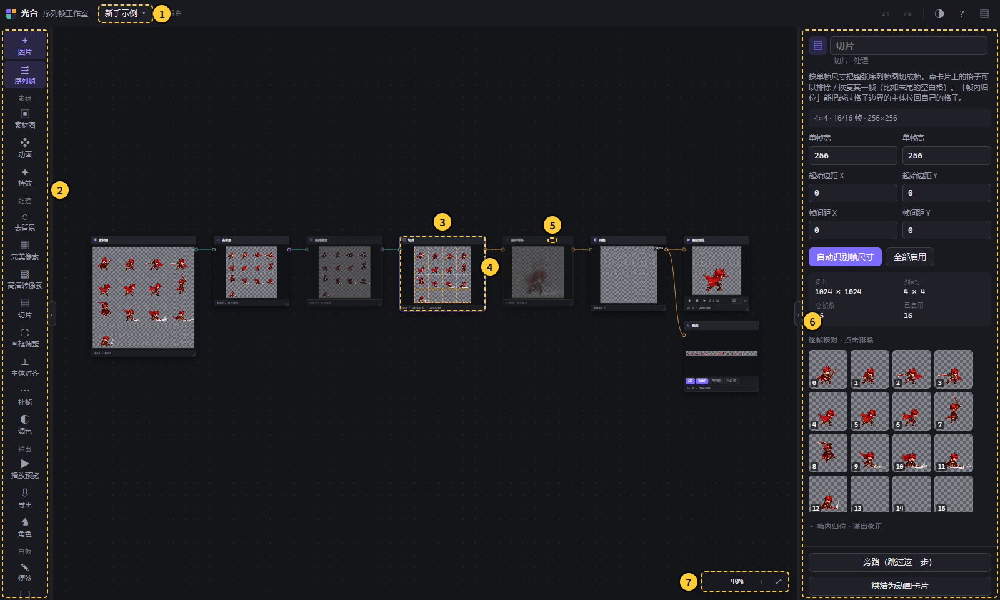

| 编号 | 区域 | 说明 |
| --- | --- | --- |
| 1 | 项目名按钮 | 点开项目菜单：新建、打开、另存为、历史版本等；旁边显示保存状态 |
| 2 | 节点栏 | 按「素材 / 处理 / 输出 / 白板」分组列出所有节点，点击或拖到画布上即可添加；顶部「＋ 图片」「序列帧」用来导入 |
| 3 | 卡片 | 每张卡片是一个节点，里面实时显示处理结果；标题栏可重命名，右下角可拖动改大小 |
| 4 | 端口与连线 | 右侧圆点是输出，左侧圆点是输入；从输出拖到输入就连上，拖动已连接的输入端口可把线拔下来 |
| 5 | 旁路按钮 | 在卡片标题栏上，打开后这一步被跳过，输入原样传给下游 |
| 6 | 属性面板 | 选中卡片的全部参数，底部有「旁路」「烘焙为动画卡片」等操作；框选多张卡片时可「用分组框起来」 |
| 7 | 缩放控件 | 显示当前缩放比例，＋ / − 缩放，最右按钮适应视图 |

顶栏右侧依次是撤销、重做、切换深色 / 浅色主题、帮助（快捷键列表）、折叠属性面板。节点栏、属性面板和画布之间的分隔条可以拖动调宽，点分隔条上的箭头或双击可以折叠。

### 画布操作

| 操作 | 方式 |
| --- | --- |
| 缩放 | 滚轮；F 适应视图 |
| 平移 | 按住空格或中键拖动 |
| 框选 | 在空白处拖动 |
| 移动卡片 | 按住卡片任意位置拖动（包括图片区域） |
| 添加节点 | 双击空白处搜索；或从输出端口拖线到空白处，只列出能接上的节点 |
| 右键菜单 | 卡片上：生成流程、烘焙、加入角色、旁路、删除等；空白处：添加节点 / 图片 / 便签 / 分组框 |
| 撤销 / 重做 | Ctrl+Z / Ctrl+Y；拖动、涂抹、调滑块都合并成一步 |
| 复制 | Ctrl+D 复制卡片，Ctrl+C / Ctrl+V 复制粘贴 |

## 4. 基本操作流程：从整图到导出

最常见的用法只要三步：拖入一张序列帧整图 → 右键「生成标准处理流程」→ 在「导出」卡片上点格式。下面以一张 1024×1024、排了 4×4 格的剑士攻击动作图为例。

### 第 1 步：导入素材

- **一张图**：直接把文件拖到画布上，或 Ctrl+V 粘贴，或点左上「＋ 图片」，得到一张「素材图」卡片。
- **一组序列帧**：点左侧「⇶ 序列帧」，按下图菜单选择来源，得到一张「动画」卡片。多张图按文件名里的数字排序；把多张图或整个文件夹直接拖到画布上也行。

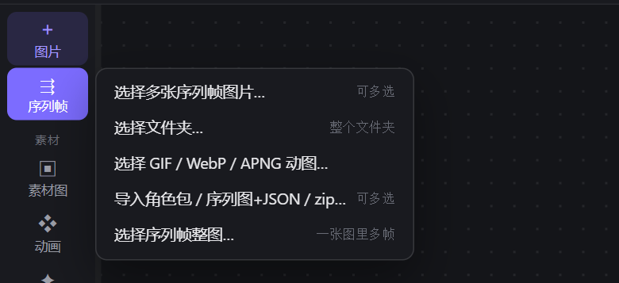

本工具导出的、Aseprite 或 TexturePacker 的「序列图 + JSON」以及角色包 zip 都能从「导入角色包 / 序列图+JSON / zip…」导入。

### 第 2 步：一键生成处理流程

在素材图卡片上右键，选「生成标准处理流程」。如果只想把整图切成可编辑的帧，选「切成动画…」就能直接得到动画卡片。

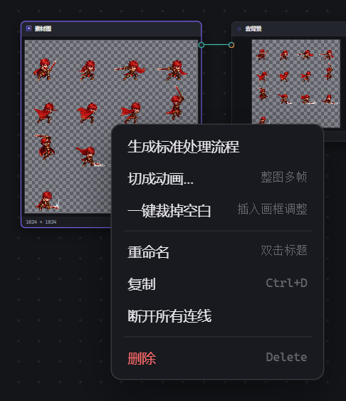

生成的流程从左到右依次是：

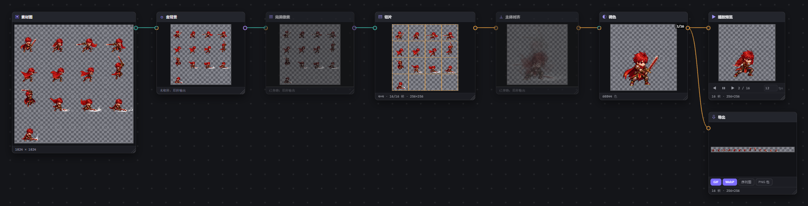

| 节点 | 作用 | 常用操作 |
| --- | --- | --- |
| 去背景 | 去掉纯色背景 | 点「取样」后在卡片图上点背景色 |
| 完美像素 | 把放大过、模糊的像素画还原到真实像素网格 | 默认旁路，素材是放大的像素画时再开 |
| 切片 | 把整图按单帧尺寸切成帧 | 「自动识别帧尺寸」；点卡片上的格子排除末尾的空白格 |
| 主体对齐 | 让每帧的角色对齐到同一位置，避免播放时抖动 | 默认旁路，需要时开启 |
| 调色 | 换色、局部涂改 | 「画笔 / 橡皮 / 魔棒」直接在图上涂 |
| 播放预览 | 循环播放当前结果 | 卡片底部可暂停、逐帧、改帧率 |
| 导出 | 输出文件 | 见第 4 步 |

切片时留意帧数：示例图只有 13 帧，切片按 4×4 切出了 16 帧，需要在切片卡片或属性面板的「逐帧核对」里点掉最后 3 个空格。

### 第 3 步：按需调整流程

- **调参**：点选任意卡片，在右侧属性面板改参数，下游所有卡片实时更新。
- **跳过一步**：点卡片标题栏的「旁路」。
- **插入新步骤**：双击空白处打开搜索框选节点；或从某张卡片的输出端口拖线到空白处，只会列出能接上的节点。

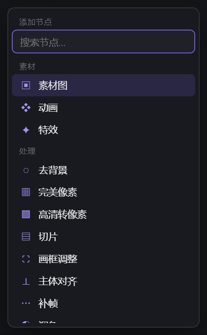

流程之外还有几个常用节点：「高清转像素」把高清图转成像素风；「画框调整」改画布大小或一键裁掉空白；「补帧」在两帧之间插入中间帧（只处理 128×128 以内的像素小图）。

### 第 4 步：导出

「导出」卡片底部有四个按钮：**GIF**、**WebP**（动画，支持半透明）、**序列图**（一张整图 + JSON）、**PNG 包**（逐帧 PNG 压缩包）。点「序列图」会先弹出设置框，选排列（一行 / 一列 / 接近正方形 / 自定列数），实时显示整图尺寸和预览。

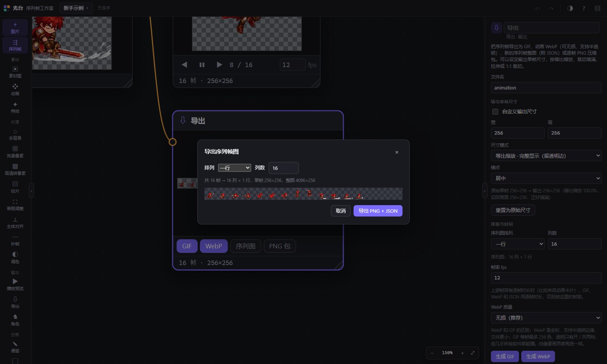

属性面板里还能设文件名、自定义输出单帧尺寸（等比缩放、裁切填满、拉伸或 1:1 裁切）、帧率和 WebP 质量。导出 GIF 时如果半透明像素较多（光效、辉光、渐隐），会提示改导 WebP 或垫底色导出。

### 保存成可编辑的动画

在任意处理结果上右键「烘焙为动画卡片」，每帧会存成项目里的图片，得到一张「动画」卡片。双击它即可进入像素编辑器逐帧修改、加特效（见第 5 节）。

## 5. 像素编辑器与特效

双击「动画」卡片进入像素编辑器。攻击拖尾、拖尾笔、特效和残影都是单独的图层，随动画保存，卡片输出和导出会自动带上。也可以从左侧栏新建一张空动画从头画（默认 32×32）。

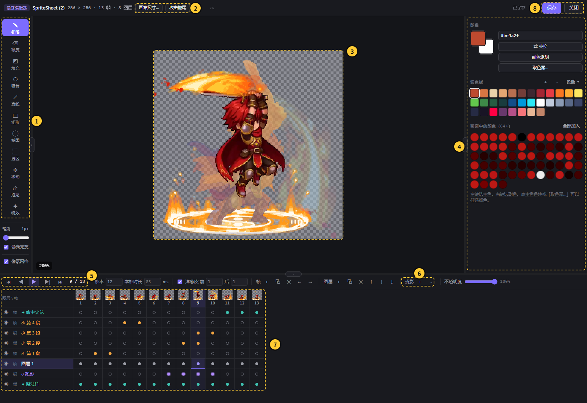

| 编号 | 区域 | 说明 |
| --- | --- | --- |
| 1 | 工具栏 | 绘图工具及「拖尾」「特效」；下方调笔刷大小、像素完美、像素网格 |
| 2 | 画布尺寸 / 攻击拖尾 | 改画布大小；进入攻击拖尾模式 |
| 3 | 画布 | 当前帧的合成画面 |
| 4 | 右侧参数栏 | 随工具和图层变化：普通图层显示颜色与调色板，选中拖尾 / 特效 / 残影图层时显示对应设置 |
| 5 | 播放控件 | 第一帧、上一帧、播放、下一帧、最后一帧；右边是帧率、本帧时长、洋葱皮、帧和图层的增删移动 |
| 6 | 残影 ＋ / － | 给当前帧加上或去掉残影 |
| 7 | 时间轴 | 图层是行、帧是列，点格子切换帧和图层；橙点 = 拖尾，紫点 = 残影，绿点 = 特效 |
| 8 | 保存 / 关闭 | 保存后画布上的卡片和下游预览、导出立即更新 |

### 绘图工具与快捷键

| 工具 | 快捷键 | 备注 |
| --- | --- | --- |
| 铅笔 | B | 默认开启「像素完美」，自动去掉斜线上的 L 形拐角 |
| 橡皮 / 填充 / 吸管 | E / G / I | 任何绘制工具按住 Alt 也是吸管 |
| 直线 / 矩形 / 椭圆 | L / U / Shift+U | |
| 选区 / 移动 | M / V | 有选区时只在选区内绘制；方向键 1px 微调 |
| 拖尾笔 | T | 见下文 |
| 特效 | F | 见下文 |

左键用主色、右键用副色，X 交换；`[` `]` 调笔刷大小；Shift+H / Shift+V 水平 / 垂直翻转；Ctrl+C / X / V 复制剪切粘贴，也能粘贴系统剪贴板里的图片。

### 攻击拖尾：给挥砍动作加刀光

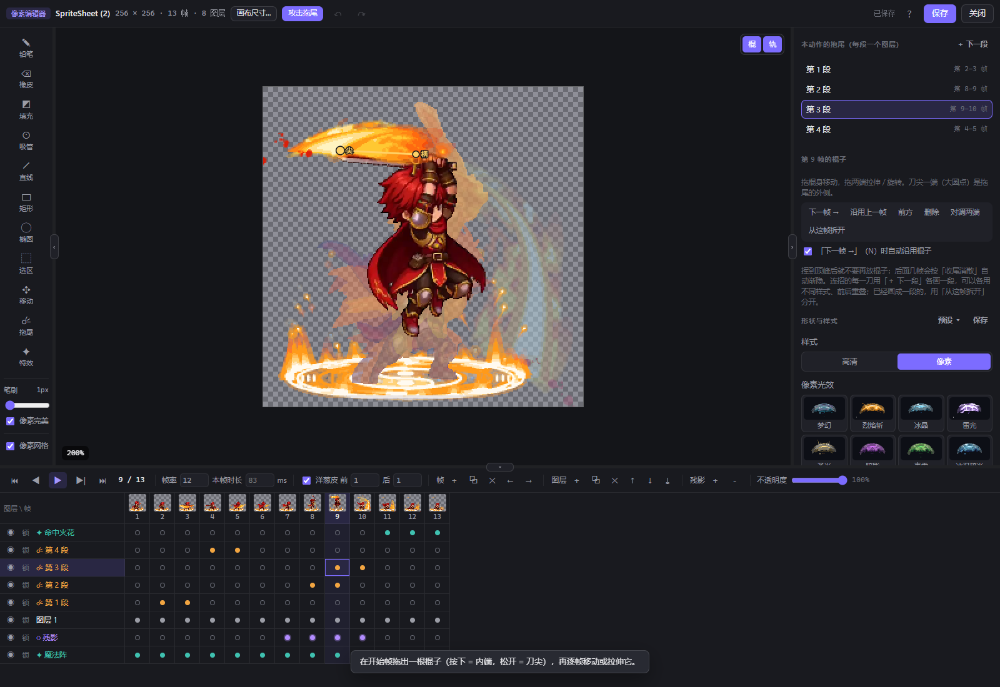

1. 切到挥砍开始的那一帧，点顶栏「攻击拖尾」。每段拖尾会自动新建一个拖尾图层。
2. 在画布上拖出一根棍子：按下的位置是内端（柄），松开的位置是刀尖，长度就是拖尾宽度。画反了会自动对调两端。
3. 在右侧选「高清 / 像素」，再点一个样式缩略图（梦幻、烈焰斩、冰晶、雷光…）。
4. 按 N（「下一帧 →」）到下一帧，棍子会沿用上一帧的位置；移动或拉伸它让它跟着武器走。每帧的拖尾由最近几帧棍子扫过的区域自动生成。
5. 挥到顶峰后不再放棍子，后面几帧会按「收尾消散」自动渐隐。
6. 连招点「＋ 下一段」：新段沿用当前样式、跳到上一段结束后的帧。列表中显示每段的帧范围，点一下即可跳过去。

常用调节：「挥动方向」在只有两三帧的大幅挥砍时指定顺 / 逆时针；「弧度」让拖尾外鼓或内收；「挥动平面」选「横扫」做水平绕身的拖尾；光效的刀锋、刀身、光晕、粒子、爆发五个总控在 0–200% 之间调。

### 拖尾笔（T）：自由画一道刀光

1. 按 T，在画布上按住拖出一道刀光，松手后变成可调的笔触图层（时间轴上显示 〜）。
2. 拖黄点（头）、蓝点（尾）改长度和方向，拖粉点改弧度，拖笔触本身整体移动。
3. 到其他帧调整后这一帧就成为关键帧（实心点），两个关键帧之间自动补间（空心点）。
4. 最后一个关键帧之后按「消失帧数」（默认 3 帧）自动收尾变淡。

勾「固定弧度」后头尾只能沿圆弧移动，再勾「循环旋转」可做一直旋转的刀光；「拖尾平面」选横向 / 纵向并勾「环绕」，远的半圈会被角色挡住。需要手修时点「转为像素图层」。

### 特效图层（F）

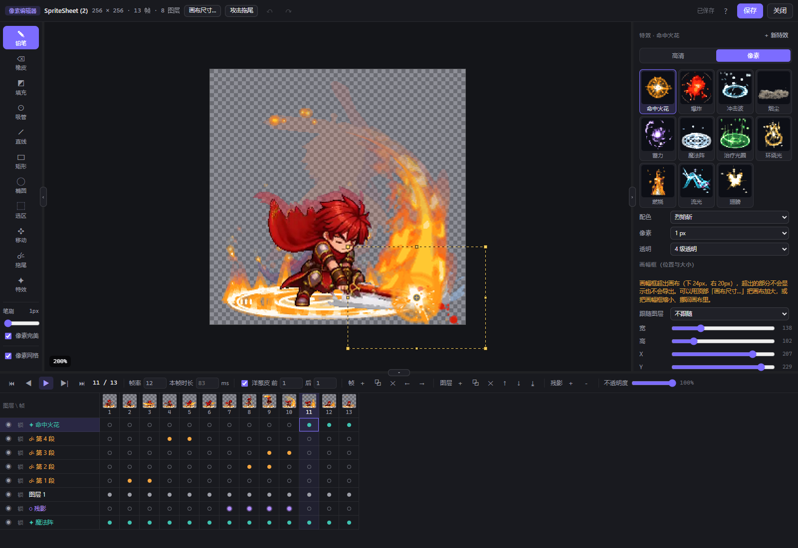

1. 切到特效开始的帧，点左侧「特效」（F），就在这一帧新建一个特效图层（时间轴上显示 ✦）。
2. 右侧选「高清 / 像素」和特效类型：命中火花、爆炸、冲击波、烟尘、蓄力、魔法阵、治疗光圈、环绕光、燃烧、流光、翅膀、云朵。
3. 选配色；在画布上拖动虚线框移动特效，拖边或角改大小（Shift 保持比例，Alt 以中心缩放）。
4. 设置开始帧、特效帧数、循环、大小、粒子、辉光等参数；「＋ 新特效」再加一个。

「燃烧」的「根部宽度」调小，火焰两侧和底边沿圆弧收拢成圆圆的底，往上鼓起再收尖，根部的火舌也抖得轻一些，就是火把上的火焰（导出成 Godot 纯代码特效也一样）。「云朵」是不规则的积云：轮廓坑坑洼洼、一边高一边低、底边也不平，有时旁边飘着一两块扯下来的碎云；一团团菜花状的云堆，左上受光发白，褶皱和平平的云底是蓝灰色的阴影，边缘半透明地化开、带一圈淡淡的雾气和细丝，颜色跟着配色微微偏色。每朵云的形状、长短、大小、浓淡都随机（「换一个随机样子」换一批）。「粒子」越多、画幅越宽，云越多：画幅宽最大可以到 2048，宽画幅就是一整片天际线（在场景里新建云朵时，画幅默认和舞台一样宽）。云团会翻滚起伏、边缘涌动；默认「横向飘动」，每朵云横着飘过，循环时正好飘一圈、首尾无缝，所以一遍的帧数越多（最多 64 帧）飘得越慢；取消「横向飘动」时云停在原地，只翻滚起伏。

「跟随图层」让特效每帧自动套住某个图层的轮廓，适合跟着角色走的环绕光；「逐帧调整」可每帧单独设位置和大小。画幅框超出画布时面板会提示，超出部分不会导出。

### 残影

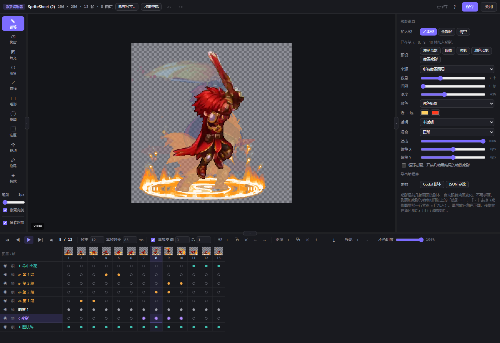

1. 切到需要残影的帧，点时间轴上方「残影 ＋」。第一次会在当前图层下方新建残影图层，这一帧把前几帧的画面复制到身后。
2. 点「－」去掉；设置面板里也有「本帧」「全部帧」「清空」。
3. 套一个预设（冲刺蓝影、暗影、炎影、原色淡影、像素残影），再按需调数量、间隔、浓度、颜色、透明方式、混合、遮挡和 X / Y 偏移。

「导出给程序」可生成 Godot 4 脚本（afterimage.gd）或通用 JSON 参数，让游戏里按真实移动实时留残影。

### 独立的「特效」节点

不需要叠在角色上时，从首页左侧栏添加「特效」卡片，单独生成一段特效序列帧。类型和参数与特效图层相同，可接「导出」节点输出，或烘焙成动画卡片后进编辑器手修。

## 6. 调帧台与角色包

调帧台把同一个角色的多组动画（待机、跑、攻击…）对齐到同一个原点，切换动画时不跳位，最后打包成角色包交给程序。

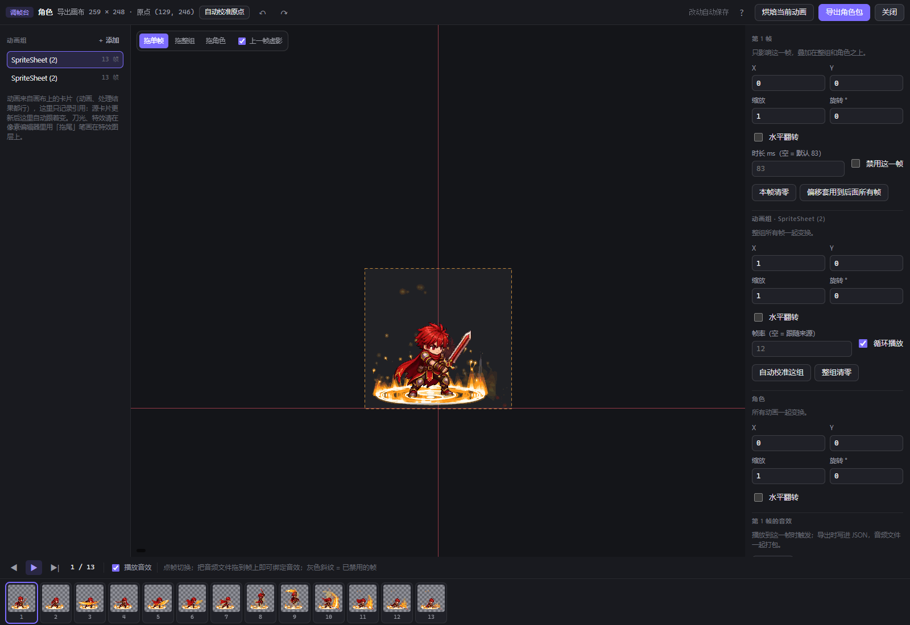

1. 在动画卡片上右键「加入角色…」，选已有角色或「新建角色」；也可以从左侧栏添加「角色」卡片。加入时脚底会自动对齐原点。
2. 双击角色卡片打开调帧台。左侧是动画组列表，「＋ 添加」可以再引用画布上的卡片；源卡片更新后这里自动跟着变。
3. 顶栏「自动校准原点」把每组可见像素的底部中心对到原点。
4. 用「拖单帧 / 拖整组 / 拖角色」（快捷键 1–3）在画面上拖动微调，方向键 1px 移动；「上一帧虚影」帮助对齐。
5. 右侧分三级设置偏移、缩放、旋转、水平翻转；单帧还能设时长、禁用这一帧，动画组可设帧率和循环播放。
6. 把 WAV / MP3 / OGG 拖到底部的帧上即可绑定音效，播放到这一帧时触发。
7. 点右上「导出角色包」。

角色包是一个 zip：所有动画共用同一块画布和同一个原点，每组一张序列图（或 PNG 序列），`character.json` 记录画布尺寸、原点、逐帧时长和音效，音频一起打包。把 zip 拖回画布即可还原。「烘焙当前动画」把调好的一组存成新的动画卡片。

## 7. 场景搭建与 Godot 场景包

场景把画布上的图片、动画、特效摆进同一个画面，调好位置、大小、前后层级和出场时间，再整体导出成 Godot 4 场景包交给程序。

1. 从首页左侧栏「输出」里添加「场景」卡片，双击打开场景编辑器。
2. 左侧素材栏列出画布上能放的卡片（动画、素材图、特效、处理结果）。点一下放到舞台中间，或拖到舞台上的任意位置。场景里只记引用：改了原卡片，场景跟着变；同一个动画可以放好几次。
3. 在舞台上拖动元素移动，拖四角的方块缩放，拖上方的圆点旋转（按住 Shift 每 15° 一格），方向键 1px 微调（Shift ×10）。双击元素打开它的源卡片编辑。元素以图片底边中点（脚底，黄色十字）为锚点。
4. 右侧设置选中元素的名称、位置、缩放、旋转、水平翻转、不透明度、延迟帧数（第几帧出现）、是否循环、不循环时播完是停在最后一帧还是消失，以及置顶 / 上移 / 下移 / 置底、复制、删除。调整上下层也可以在时间轴上下拖元素名字（从上到下就是从顶层到底层）、在舞台上右键元素，或用 Ctrl+] / Ctrl+[ 上移 / 下移一层（加 Shift 置顶 / 置底）。背景图放进来后点「铺满舞台」。没选中元素时设置舞台尺寸、帧率、时长（0 = 自动：按帧数最多的那个元素，加上它的延迟帧数）和背景色。场景里每个元素都是一帧放它自己的一帧，快慢统一由场景帧率决定（导出 GIF 和 Godot 场景包也一样）。
5. 左侧最上面是「预设 · 魔幻村庄」素材包：建筑（锻造屋、民居、魔法祭坛、水井）、植物（古树、灌木、野花）、装饰（灯柱、木栅栏、旗帜、符文石、吊灯、路标、告示板、长凳）、道具（木桶、木箱、麻袋、草垛、宝箱、陶罐、手推车、原木堆、藤筐）、远景（浮空遗迹、远山），点一下或拖到舞台上，按素材包里各物件的相对大小放进来（和示例村庄同一个比例）；「地面」里的「草地小路」是一整张画好的地面（草地、土路、带石块和树根的土层剖面），左右无缝，点一下就沿舞台底部横向铺满，高度约占舞台的 27%；选中任何一条地面，右侧「地面」里可以只改宽度（高度不变：整张地面无缝重复、在宽度处截断，图块地面按格子铺），也有「铺满舞台宽度」和 ±100；同一张地面被几个图层共用时，改宽度会自动给这个图层复制一张，适合做几段长短不一的平台；自己导入的地面图也一样：选中它，右侧「横向平铺（当地面用）」里改宽度，图片横着重复、在宽度处截断（图的左右边缘能接上就看不出接缝），第一次修改会另外生成一张「地面 · 原名」卡片给这个图层，原来的图片卡片不动；其余地面用 16×16 图块（沙地 / 草地 / 泥土 / 石面，变体随机混排，可加草边）在舞台底部铺一条，自动放在远景层上面；标题右边的「示例场景」按素材包的示意图一键摆好整个村庄（天空色、远山、房屋、古树、祭坛、沙地）。预设第一次用到时会在画布上生成一张素材图卡片（图片复制进项目，以后不依赖素材包），之后再用就引用同一张卡片。
6. 预设下面是「特效」：火焰、魔法阵、冲击波、云朵等所有特效类型都在这里，点一下放到舞台中间，或拖到舞台上任意位置。每放一个就在画布上新建一张特效卡片（和场景卡片放在一起），选中后右侧「特效参数」里直接改类型、配色、大小、根部宽度、粒子等。每个图层的特效参数单独调整：复制出来的图层、或者多个图层用了同一张特效卡片时，改其中一个会自动给它复制一张自己的特效卡片（画布上多一张，名字带序号），其他图层不受影响；撤销一次就回到原样。
7. 底部时间轴每行一个元素（名字右边的 × 把它从场景里删掉，原卡片不受影响；在画布上删掉一张卡片时，场景里用到它的元素也一起删掉，撤销一次都回来）：条从出现画到播完，斜纹表示循环一直播；左右拖条改出现时间，点刻度跳到那一帧，Enter 播放。
8. 点右上「导出 Godot 场景…」（场景卡片的属性面板里也有）。
9. 要导出成 GIF / WebP / 序列图 / PNG 包：从场景卡片右边的「序列帧」输出连一张「导出」卡片（或者拖到空白处直接新建），和动画一样导出。输出的是整个舞台（舞台大小、带背景色），帧数是场景的时长，帧率是场景的帧率；场景里引用的卡片改了，导出卡片里的画面也跟着更新。没连导出卡片时场景不会逐帧生成画面，在编辑器里拖动元素不会变慢。

导出的 zip 解压后放进 Godot 项目，打开里面的场景文件即可：

- 每个动画导出成一个分层子场景（`actors/` 里的 `actor.tscn`，和动画卡片的「分层导出」一样，攻击拖尾、动画里的特效也能选导出成运行时脚本或纯代码），主场景实例化它们并摆好位置；同一个动画放了几次也只导出一份。
- 直接放进场景的特效卡片按导出窗口里「场景里的特效」导出：默认「纯代码」，导出一个 `vfx_code.gd`，每个特效是一个 Node2D 下挂一个 `Effect` 节点，由 Godot 实时画（不带图片，放大也清晰，参数都能在检查器里改）；`scene.gd` 到出现时间才让它开始播，元素循环而特效只播一次时会自动重播。所有特效类型（包括云朵和魔法阵的各种地面光环）都能导出成纯代码；纯代码画面是平滑的，不做像素化。选「烘焙成序列帧图片」则全部按图片导出。
- 图片导出成 Sprite2D，其余序列帧导出成 AnimatedSprite2D（裁到画面出现过的范围）；只被缩小显示的大图（比如预设里的建筑原画）按它在场景里最大的显示比例预先平滑缩小，Godot 里不会出现锯齿，导出包也小得多。
- 主场景带背景色、对着舞台中间的 Camera2D，根节点脚本 `scene.gd` 让每个元素到了出现时间才显示并开始播放，整段播完后循环（`loop`、`autoplay`、`length` 都能在检查器里改，播完发出 `scene_finished`）。
- 被引用的文件都用英文名，解压工具把中文名弄乱也不影响场景打开。另附 `*_scene.json` 给其他引擎用。
- Godot 项目的窗口大小设成舞台尺寸，画面就和编辑器里一样。

## 8. 常见问题

| 现象 | 原因 | 处理 |
| --- | --- | --- |
| 双击 start.bat 提示「没有找到 Node.js」 | 未安装 Node.js | 安装 Node.js 18 或更新版本后重新双击 |
| 黑窗口提示「端口 5288 已被占用」 | 工作室已经在运行 | 直接在浏览器打开 http://127.0.0.1:5288/ |
| 页面提示「连不上本地服务」 | start.bat 的窗口被关了 | 重新双击 start.bat，然后刷新页面 |
| 切片后多出几帧空白 | 整图最后一行没排满 | 在切片卡片或属性面板「逐帧核对」里点掉空格 |
| 导出的 GIF 光效边缘发硬、有杂边 | GIF 只有全透明 / 不透明两档 | 按提示改导 WebP，或选「垫底色导出 GIF」 |
| 「补帧」节点原样输出 | 只处理 128×128 以内的像素小图 | 先用「画框调整」或「高清转像素」缩小 |
| 补帧后出现撕裂或重影 | 大幅挥动、快速旋转难以追踪 | 补帧更适合平移和小幅动作；可改用「淡入淡出混合」 |
| 特效被切掉一部分 | 画幅框超出了画布 | 用顶栏「画布尺寸…」加大画布，或缩小、挪回画幅框 |
| 拖尾拧成了麻花 | 棍子的柄和尖画反了 | 通常会自动纠正；也可以点「对调两端」 |
| 改坏了想回到之前 | — | Ctrl+Z 撤销；更早的版本用项目菜单「历史版本…」还原 |
| 项目文件夹越来越大 | 编辑过的帧会在 assets 里留下旧版本 | 关闭像素编辑器后，用项目菜单「清理未使用素材…」 |
| 删除了项目又想找回来 | 删除只是移动文件夹 | 到 `data/trash/` 里找回，再用「打开项目…」选它的 `project.gtproj` |

更多快捷键：在首页不选中任何卡片时，右侧属性面板会列出全部画布快捷操作；顶栏「?」也能打开帮助。
